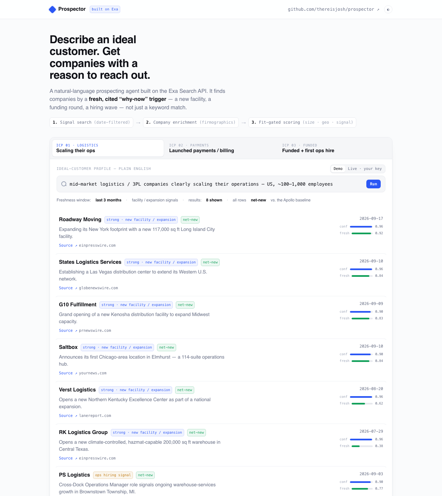

# Prospector

A natural-language B2B prospecting agent built on the [Exa](https://exa.ai) Search API. Describe an ideal-customer profile (ICP) in plain English; Prospector finds companies that match it **via a fresh, verifiable "why-now" trigger** — a new-facility announcement, a funding round, a hiring wave — and returns a structured, cited brief for each.

Built as a hands-on exploration of Exa's API against a self-authored customer scenario (a mid-market ops-software company that wants trigger-based outbound). AI-assisted build; the architecture, API decisions, and evaluation are mine.

## Live demo
**[thereisjosh.github.io/prospector](https://thereisjosh.github.io/prospector)** — cached results out of the box; flip to **Live · your key** to run a real signal search on your own Exa key. The key stays in your browser (`localStorage`) and is sent only to `api.exa.ai` — there is no server.



## The result — ICP 1 (logistics ops, scaling)
See [`sample_output.md`](./sample_output.md): US mid-market 3PLs, each with a dated, cited scaling signal (new distribution center, expansion, hiring wave) — scored ~8/10 against the scenario's acceptance bar, and specifically *not* the enterprise giants a keyword filter surfaces.

## The design decision that shaped everything: signal-first
I probed Exa's live API before building, and hit a constraint that determined the architecture:

> `category: "company"` uses a **semantic-only index that rejects `startPublishedDate`** — you cannot date-filter a company search.

The customer's need is *freshness* (a trigger from the last ~3 months), so I inverted the pipeline — filter freshness on the **trigger**, not the company:

1. **Signal search** — general index, `startPublishedDate`-filtered → find the fresh *trigger* (a press release / job post) that names the company.
2. **Company enrichment** — `category:"company"` (no date) → pull firmographics (size, industry, HQ) to gate on fit.
3. **Score & rank** — firmographic-fit × signal-strength × freshness.

## How it works
`/search` (neural, date-filtered, with `contents.{highlights, summary+schema}`) → dedupe → `/search category:"company"` enrichment (cached) → firmographic gate (size band, geo, is-3PL, enterprise denylist) → confidence/freshness scoring → top 10–15. **Exa-only; no other LLM.** All logic lives in 5 small files under [`src/`](./src) — `config.ts` holds the tunable per-ICP behavior.

## Eval-driven, not vibes
Every iteration was scored against the scenario's 0–10 bar:

| Version | Change | Score |
|---|---|:--:|
| v1 | signal-first pipeline, ICP 1 | real+fresh signals, but off-profile companies leaked in → **~5.5** |
| v2 | firmographic enrichment + gating + facility/funding signals | **~8** |
| v3 | tightened gates | recall collapsed (10 rows → 3) — the precision/recall tradeoff, live |
| v4 | re-tuned recall; generalized to 3 ICPs | ICP 1 solid |

Deterministic checks (Vitest): signal date in window · source URL resolves · **company matches the signal entity** (guards the "congratulated the wrong company" failure mode) · net-new vs a baseline list.

## Scope & honesty
- **ICP 1 (logistics) is solid.** **ICP 2 (payments-launch)** and **ICP 3 (funded + first-ops-hire)** are config-driven and earlier-stage: the clean "facility-announcement" signal that nails logistics doesn't transfer — each ICP needs its own signal strategy.
- **AI-assisted** (orchestrated via a coding agent); the architecture, the live-API verification, and the eval design are mine.
- **Cost** scales with enrichment depth (~$0.06–$0.9 per ICP run by config) — a real build-vs-buy consideration, and a knob you tune.

## Run it
Needs an Exa API key (free tier at [exa.ai](https://exa.ai)).
```bash
cp .env.example .env      # add your EXA_API_KEY
npm install
npm run prospect -- --icp 1     # or 2 | 3 | all
```

## More
- [`SPEC.md`](./SPEC.md) — full build spec, including the verified Exa API shapes (§8).
- [`REQUIREMENTS.md`](./REQUIREMENTS.md) — the customer scenario + the three ICPs.

Stack: TypeScript / Node · Exa Search API · Vitest.
